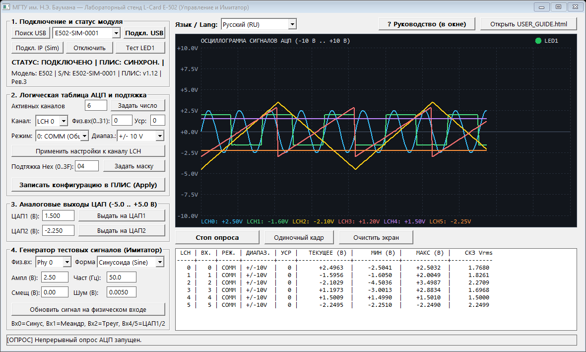
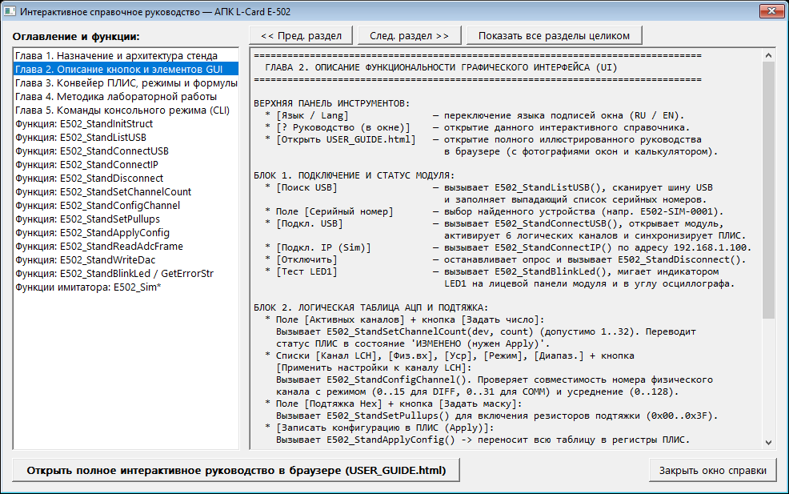
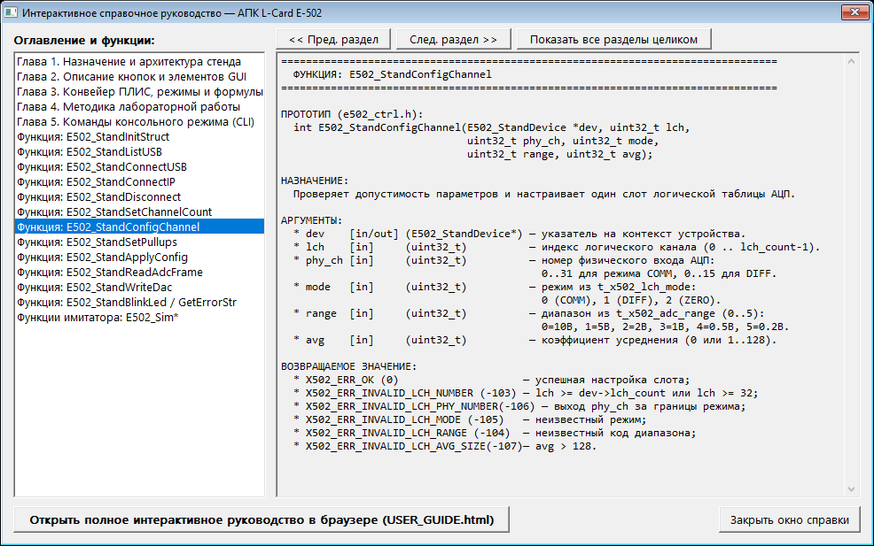
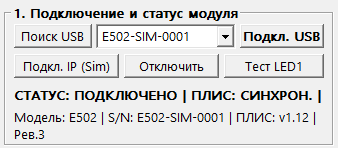
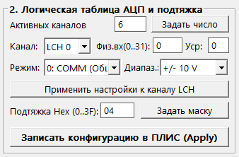
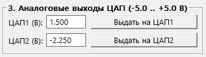
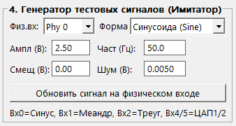
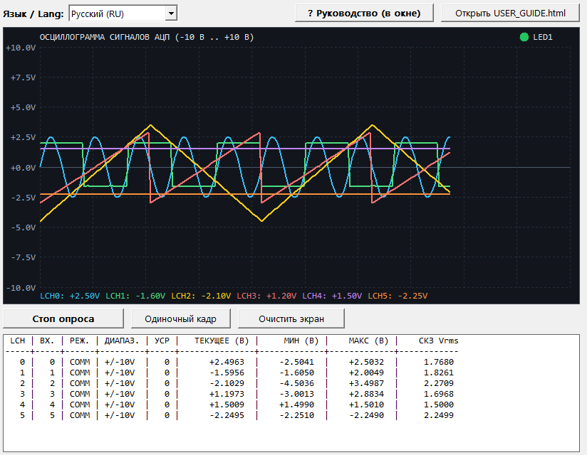

# Руководство пользователя и справочник функций АПК L-Card E-502

**Организация:** МГТУ им. Н.Э. Баумана  
**Аппаратная платформа:** L-Card E-502 (USB 2.0 / 100BASE-TX Ethernet, 16-разрядный АЦП/ЦАП)  
**Исполняемые модули:** `stand_gui.exe` (Win32 GUI), `stand_cli.exe` (CLI), `test_stand.exe` (автотесты)  
**Интерактивная версия руководства:** `USER_GUIDE.html` (доступна из главного окна приложения)

---

## Оглавление (Быстрый переход по главам)

1. [Глава 1. Назначение и архитектура стенда](#глава-1-назначение-и-архитектура-стенда)
2. [Глава 2. Описание функциональности графического интерфейса (UI, окна и кнопки)](#глава-2-описание-функциональности-графического-интерфейса-ui-окна-и-кнопки)
3. [Глава 3. Полный справочник пользовательских функций и их аргументов](#глава-3-полный-справочник-пользовательских-функций-и-их-аргументов)
4. [Глава 4. Конвейер ПЛИС (FPGA), режимы коммутации и поддиапазоны АЦП](#глава-4-конвейер-плис-fpga-режимы-коммутации-и-поддиапазоны-ацп)
5. [Глава 5. Методика выполнения лабораторной работы](#глава-5-методика-выполнения-лабораторной-работы)
6. [Глава 6. Консольный режим (CLI) и сборка проекта](#глава-6-консольный-режим-cli-и-сборка-проекта)

---

## Глава 1. Назначение и архитектура стенда

Программный комплекс предназначен для управления 16-разрядным модулем аналого-цифрового и цифро-аналогового ввода-вывода **L-Card E-502**. Архитектура разделена на три изолированных уровня:

| Модуль (файлы) | Назначение |
|---|---|
| `e502_ctrl.h`, `e502_ctrl.c` | Безопасная обёртка над драйвером L-Card (`x502api` / `e502api`). Инкапсулирует состояние `E502_StandDevice`, контролирует жизненный цикл дескриптора `t_x502_hnd` и проверяет границы всех входных аргументов до обращения к аппаратуре. |
| `e502_sim.h`, `e502_sim.c` | Математический имитатор физического тракта (32 физических входа АЦП, 2 канала ЦАП, регистры ПЛИС, дифференциальное вычитание, аппаратное усреднение шума в $\sqrt{\text{Avg}}$ раз). |
| `main_gui.c`, `main_cli.c`, `test_stand.c` | Графическое рабочее место оператора (`stand_gui.exe`), интерактивная командная оболочка (`stand_cli.exe`) и модульные автотесты (`test_stand.exe`). |

---

## Глава 2. Описание функциональности графического интерфейса (UI, окна и кнопки)



### 2.1. Верхняя панель управления и встроенное окно справки


- **`Язык / Lang`** (`COMBOBOX`): мгновенное переключение подписей элементов интерфейса главного окна между русским (`Русский (RU)`) и английским (`English (EN)`) языками без перезапуска программы.
- **`[? Руководство (в окне)]`** (`BUTTON`): открывает встроенное интерактивное справочное окно с оглавлением по главам и по всем 20 функциям API.
- **`[Открыть USER_GUIDE.html]`** (`BUTTON`): открывает интерактивное HTML-руководство с иллюстрациями, поиском по функциям и тренажёром вызовов API в системном браузере.





### 2.2. Блок 1 — «1. Подключение и статус модуля»



| Элемент UI | Вызываемая функция C API | Описание действия |
|---|---|---|
| Кнопка **`[Поиск USB]`** | `E502_StandListUSB()` | Сканирует шину USB и заполняет выпадающий список серийных номеров обнаруженных приборов. |
| Поле **`[Серийный номер]`** | Аргумент `serial` | Выбор обнаруженного серийного номера (например, `E502-SIM-0001`) или ручной ввод. |
| Кнопка **`[Подкл. USB]`** | `E502_StandConnectUSB()` | Открывает связь по USB, активирует 6 логических каналов и синхронизирует регистры ПЛИС. |
| Кнопка **`[Подкл. IP (Sim)]`** | `E502_StandConnectIP()` | Подключается к модулю по Ethernet (`192.168.1.100`, таймаут `1000 мс`). |
| Кнопка **`[Отключить]`** | `E502_StandDisconnect()` | Останавливает опрос АЦП, закрывает соединение `X502_Close` и освобождает дескриптор `X502_Free`. |
| Кнопка **`[Тест LED1]`** | `E502_StandBlinkLed()` | Мигает светодиодом `LED1` на корпусе прибора и в правом верхнем углу осциллографа. |

### 2.3. Блок 2 — «2. Логическая таблица АЦП и подтяжка»



| Элемент UI | Вызываемая функция C API | Описание действия |
|---|---|---|
| Поле **`[Активных каналов]`** + **`[Задать число]`** | `E502_StandSetChannelCount()` | Устанавливает размер таблицы опроса АЦП (`1..32`). Помечает статус ПЛИС как `ИЗМЕНЕНО`. |
| Списки **`[Канал]`**, **`[Физ.вх]`**, **`[Уср]`**, **`[Режим]`**, **`[Диапаз.]`** + **`[Применить настройки к каналу LCH]`** | `E502_StandConfigChannel()` | Проверяет допустимость параметров (`0..15` для `DIFF`, `0..31` для `COMM`, `avg <= 128`) и сохраняет настройки слота. |
| Поле **`[Подтяжка Hex]`** + **`[Задать маску]`** | `E502_StandSetPullups()` | Задаёт шестнадцатеричную маску резисторов подтяжки цифровых линий (`0x00..0x3F`). |
| Кнопка **`[Записать конфигурацию в ПЛИС (Apply)]`** | `E502_StandApplyConfig()` | Записывает всю таблицу в регистры ПЛИС (`X502_Configure`) и переводит статус в `СИНХРОН.`. |

### 2.4. Блок 3 — «3. Аналоговые выходы ЦАП (-5.0 .. +5.0 В)»



| Элемент UI | Вызываемая функция C API | Описание действия |
|---|---|---|
| Поле **`[ЦАП1 (В)]`** + **`[Выдать на ЦАП1]`** | `E502_StandWriteDac(dev, 0, v)` | Выдаёт калиброванное напряжение `[-5.000; +5.000] В` на 1-й канал ЦАП (в имитаторе заведён на `Phy 4`). |
| Поле **`[ЦАП2 (В)]`** + **`[Выдать на ЦАП2]`** | `E502_StandWriteDac(dev, 1, v)` | Выдаёт калиброванное напряжение `[-5.000; +5.000] В` на 2-й канал ЦАП (в имитаторе заведён на `Phy 5`). |

### 2.5. Блок 4 — «4. Генератор тестовых сигналов (Имитатор)»



| Элемент UI | Вызываемая функция C API | Описание действия |
|---|---|---|
| Список **`[Физ.вх: Phy 0..31]`** | `E502_SimGetPhySignal()` | Выбирает физический вход имитатора и загружает его текущие параметры. |
| Список **`[Форма]`**, поля **`[Ампл]`**, **`[Част]`**, **`[Смещ]`**, **`[Шум]`** + **`[Обновить сигнал на физическом входе]`** | `E502_SimSetPhySignal()` | Настраивает закон сигнала (Синусоида, Меандр, Треугольник, Пила, DC, Петля с ЦАП1/ЦАП2) на выбранном входе. |

### 2.6. Правая панель — Цифровой осциллограф и измерительная таблица



- **`[Старт опроса (20 Гц)] / [Стоп опроса]`**: запускает или останавливает циклический вызов `E502_StandReadAdcFrame()` с периодом 50 мс.
- **`[Одиночный кадр]`**: считывает ровно один синхронный кадр по всем активным логическим каналам.
- **`[Очистить экран]`**: сбрасывает буфер осциллографа и накопленную статистику (`МИН`, `МАКС`, `СКЗ Vrms`).

---

## Глава 3. Полный справочник пользовательских функций и их аргументов

### 3.1. Функции модуля управления стендом (`e502_ctrl.h`)

#### 1. `E502_StandInitStruct`
```c
void E502_StandInitStruct(E502_StandDevice *dev);
```
- **Назначение:** Безопасная инициализация контекста устройства. Если структура уже содержала открытый дескриптор (`init_magic == E502_STAND_MAGIC && hnd != NULL`), предварительно вызывает `E502_StandDisconnect(dev)`.
- **Аргументы:**
  - `dev` (`E502_StandDevice *`, `[in/out]`): указатель на структуру устройства. После вызова: `lch_count = 4`, каналы `0..31` в режиме `COMM` (`±10 В`), `pullups_mask = 0x04`, `config_dirty = true`.

#### 2. `E502_StandListUSB`
```c
int E502_StandListUSB(char serials[][X502_SERIAL_SIZE], uint32_t max_count, uint32_t *found_count);
```
- **Назначение:** Сканирует шину USB и заполняет массив серийных номеров доступных модулей E-502.
- **Аргументы:**
  - `serials` (`char [][32]`, `[out]`): выходной буфер строк длиной не менее `max_count` элементов.
  - `max_count` (`uint32_t`, `[in]`): максимальное число записей в буфере `serials`.
  - `found_count` (`uint32_t *`, `[out]`): указатель для записи общего числа найденных модулей (допускается `NULL`).
- **Возвращает:** `X502_ERR_OK (0)` или код ошибки `X502_ERR_*`.

#### 3. `E502_StandConnectUSB`
```c
int E502_StandConnectUSB(E502_StandDevice *dev, const char *serial);
```
- **Назначение:** Создаёт дескриптор `X502_Create()`, открывает модуль по USB через `E502_OpenUsb()` и считывает `X502_GetDevInfo()`.
- **Аргументы:**
  - `dev` (`E502_StandDevice *`, `[in/out]`): контекст устройства.
  - `serial` (`const char *`, `[in]`): серийный номер прибора; если `NULL` или `""`, автоматически выбирается первый найденный модуль на шине USB.
- **Возвращает:** `X502_ERR_OK (0)`, `X502_ERR_DEVICE_NOT_FOUND (-3)`, `X502_ERR_MEMORY_ALLOC (-2)`.

#### 4. `E502_StandConnectIP`
```c
int E502_StandConnectIP(E502_StandDevice *dev, uint32_t ip_addr, uint32_t timeout_ms);
```
- **Назначение:** Открывает соединение с модулем по сети Ethernet (`E502_OpenByIpAddr`).
- **Аргументы:**
  - `dev` (`E502_StandDevice *`, `[in/out]`): контекст устройства.
  - `ip_addr` (`uint32_t`, `[in]`): 32-битный IPv4-адрес в хост-порядке байт (например, `0xC0A80164` для `192.168.1.100`).
  - `timeout_ms` (`uint32_t`, `[in]`): таймаут установки TCP-соединения в миллисекундах.
- **Возвращает:** `X502_ERR_OK (0)` или отрицательный код ошибки.

#### 5. `E502_StandDisconnect`
```c
int E502_StandDisconnect(E502_StandDevice *dev);
```
- **Назначение:** Закрывает соединение (`X502_Close`), освобождает дескриптор (`X502_Free`) и сбрасывает `is_connected = false`.
- **Аргументы:**
  - `dev` (`E502_StandDevice *`, `[in/out]`): контекст устройства.

#### 6. `E502_StandSetChannelCount`
```c
int E502_StandSetChannelCount(E502_StandDevice *dev, uint32_t count);
```
- **Назначение:** Задаёт активное число логических каналов АЦП и устанавливает `config_dirty = true`.
- **Аргументы:**
  - `dev` (`E502_StandDevice *`, `[in/out]`): контекст устройства.
  - `count` (`uint32_t`, `[in]`): число каналов в диапазоне `1..32` (`STAND_MAX_CHANNELS`).
- **Возвращает:** `X502_ERR_OK (0)` или `X502_ERR_INVALID_LCH_COUNT (-102)`.

#### 7. `E502_StandConfigChannel`
```c
int E502_StandConfigChannel(E502_StandDevice *dev, uint32_t lch, uint32_t phy_ch,
                            uint32_t mode, uint32_t range, uint32_t avg);
```
- **Назначение:** Проверяет совместимость параметров и настраивает один слот логической таблицы АЦП.
- **Аргументы:**
  - `dev` (`E502_StandDevice *`, `[in/out]`): контекст устройства.
  - `lch` (`uint32_t`, `[in]`): индекс логического канала (`0 .. dev->lch_count - 1`).
  - `phy_ch` (`uint32_t`, `[in]`): номер физического входа (`0..31` для `COMM`, `0..15` для `DIFF`).
  - `mode` (`uint32_t`, `[in]`): режим входа (`0` = `COMM`, `1` = `DIFF`, `2` = `ZERO`).
  - `range` (`uint32_t`, `[in]`): код поддиапазона напряжения (`0` = ±10 В, `1` = ±5 В, `2` = ±2 В, `3` = ±1 В, `4` = ±0.5 В, `5` = ±0.2 В).
  - `avg` (`uint32_t`, `[in]`): коэффициент аппаратного усреднения в ПЛИС (`0` или `1..128`).
- **Возвращает:** `X502_ERR_OK (0)`, `X502_ERR_INVALID_LCH_NUMBER (-103)`, `X502_ERR_INVALID_LCH_PHY_NUMBER (-106)`, `X502_ERR_INVALID_LCH_MODE (-105)`, `X502_ERR_INVALID_LCH_RANGE (-104)`, `X502_ERR_INVALID_LCH_AVG_SIZE (-107)`.

#### 8. `E502_StandSetPullups`
```c
int E502_StandSetPullups(E502_StandDevice *dev, uint32_t pullups_mask);
```
- **Назначение:** Устанавливает битовую маску резисторов подтяжки цифровых входов.
- **Аргументы:**
  - `dev` (`E502_StandDevice *`, `[in/out]`): контекст устройства.
  - `pullups_mask` (`uint32_t`, `[in]`): битовая маска в диапазоне `0x00..0x3F`.

#### 9. `E502_StandApplyConfig`
```c
int E502_StandApplyConfig(E502_StandDevice *dev);
```
- **Назначение:** Транзакционно записывает все настройки в регистры ПЛИС (`X502_SetMode` -> `X502_SetLChannelCount` -> `X502_SetLChannel` -> `X502_SetDigInPullup` -> `X502_Configure`) и сбрасывает `config_dirty = false`.
- **Аргументы:**
  - `dev` (`E502_StandDevice *`, `[in/out]`): указатель на открытое устройство.

#### 10. `E502_StandReadAdcFrame`
```c
int E502_StandReadAdcFrame(E502_StandDevice *dev, double *volts_buf, uint32_t timeout_ms);
```
- **Назначение:** Считывает один полный синхронный кадр отсчётов АЦП в Вольтах (при необходимости автоматически вызывая `E502_StandApplyConfig`).
- **Аргументы:**
  - `dev` (`E502_StandDevice *`, `[in/out]`): контекст устройства.
  - `volts_buf` (`double *`, `[out]`): выходной массив размером не менее `dev->lch_count` элементов `double`.
  - `timeout_ms` (`uint32_t`, `[in]`): таймаут ожидания кадра в миллисекундах.

#### 11. `E502_StandWriteDac`
```c
int E502_StandWriteDac(E502_StandDevice *dev, uint32_t channel, double volts);
```
- **Назначение:** Асинхронная выдача калиброванного постоянного напряжения на выход ЦАП.
- **Аргументы:**
  - `dev` (`E502_StandDevice *`, `[in/out]`): контекст устройства.
  - `channel` (`uint32_t`, `[in]`): `0` (`X502_DAC_CH1`) или `1` (`X502_DAC_CH2`).
  - `volts` (`double`, `[in]`): конечное напряжение в диапазоне `[-5.000; +5.000] В`.

#### 12. `E502_StandBlinkLed` и 13. `E502_StandGetErrorStr`
```c
int         E502_StandBlinkLed(E502_StandDevice *dev);
const char* E502_StandGetErrorStr(const E502_StandDevice *dev);
```
- **Аргументы:** `dev` — указатель на контекст устройства. `E502_StandBlinkLed` переключает индикатор `LED1`, а `E502_StandGetErrorStr` возвращает строковое описание кода `dev->last_error`.

---

### 3.2. Функции модуля имитации сигналов (`e502_sim.h`)

| Прототип функции | Описание аргументов и действия |
|---|---|
| `void E502_SimReset(void)` | Без аргументов. Сбрасывает состояние имитатора, часы и эталонные сигналы на входах `0..31`. |
| `void E502_SimSetPhySignal(uint32_t phy_ch, E502_SimWaveType type, double amplitude_v, double freq_hz, double offset_v, double noise_v)` | `phy_ch` (`0..31`) — физический вход; `type` (`0..6`) — форма волны; `amplitude_v` — амплитуда (В); `freq_hz` — частота (Гц); `offset_v` — смещение (В); `noise_v` — амплитуда шума (В). |
| `void E502_SimGetPhySignal(uint32_t phy_ch, E502_SimSignalCfg *out_cfg)` | `phy_ch` (`0..31`) — номер входа; `out_cfg` (`[out]`) — указатель на структуру, куда копируются параметры сигнала. |
| `void E502_SimStepTime(double dt_sec)` | `dt_sec` (`> 0.0`) — приращение модельного времени в секундах. |
| `double E502_SimGetTime(void)` | Возвращает текущее модельное время в секундах. |
| `void E502_SimInjectFault(int32_t err_code)` | `err_code` — код ошибки `X502_ERR_*`, который будет принудительно возвращён при следующем вызове `X502_Configure()`. |
| `E502_SimStats E502_SimGetStats(void)` | Возвращает структуру `E502_SimStats` со счётчиками `active_handles`, `open_connections`, `configure_calls`, `adc_frame_reads`, `dac_writes`, `led_blinks`. |

---

## Глава 4. Конвейер ПЛИС (FPGA), режимы коммутации и поддиапазоны АЦП

1. **Режим с общей землёй (`X502_LCH_MODE_COMM = 0`)**: измеряется напряжение на входе `phy_ch` (`0..31`) относительно общей аналоговой земли `AGND`.
2. **Дифференциальный режим (`X502_LCH_MODE_DIFF = 1`)**: измеряется разность потенциалов $U_{\text{DIFF}}(k) = U_{\text{phy}}(k) - U_{\text{phy}}(k + 16)$ для $k \in [0; 15]$.
3. **Режим измерения нуля (`X502_LCH_MODE_ZERO = 2`)**: вход мультиплексора подключается к внутреннему нулю для оценки собственного смещения тракта АЦП.
4. **Аппаратное усреднение (`avg = 1..128`)**: ПЛИС усредняет `avg` последовательных выборок, снижая СКО случайного шума в $\sqrt{\text{avg}}$ раз.

---

## Глава 5. Методика выполнения лабораторной работы

1. **Подключение и диагностика:** нажмите `[Поиск USB]` -> `[Подкл. USB]` -> `[Тест LED1]`.
2. **Многоканальный опрос в режиме COMM:** задайте `6` каналов, нажмите `[Задать число]` -> `[Записать конфигурацию в ПЛИС (Apply)]` -> `[Старт опроса (20 Гц)]`. Снимите показания `МИН`, `МАКС` и `СКЗ Vrms`.
3. **Проверка тракта ЦАП -> АЦП:** подайте различные напряжения на `ЦАП1` и `ЦАП2` в пределах `[-5.0; +5.0] В` и проконтролируйте их чтение на каналах `LCH 4` и `LCH 5`.
4. **Исследование подавления шума:** задайте шум `0.25 В` на входе `Phy 4` и сравните разброс отсчётов при `Уср = 1` и `Уср = 64`.
5. **Дифференциальное измерение:** подайте постоянные уровни на `Phy 0` и `Phy 16`, переключите `LCH 0` в режим `1: DIFF` и проверьте вычитание синфазной помехи.

---

## Глава 6. Консольный режим (CLI) и сборка проекта

```powershell
# Сборка графического рабочего места (Win32 GUI):
C:\msys64\mingw64\bin\gcc.EXE -Wall -Wextra -Werror -O2 main_gui.c e502_ctrl.c e502_sim.c -lgdi32 -lcomctl32 -lshell32 -lm -mwindows -o stand_gui.exe

# Сборка интерактивной консоли (CLI):
C:\msys64\mingw64\bin\gcc.EXE -Wall -Wextra -Werror -O2 main_cli.c e502_ctrl.c e502_sim.c -lm -o stand_cli.exe

# Сборка и запуск автоматических тестов:
C:\msys64\mingw64\bin\gcc.EXE -Wall -Wextra -Werror -O2 test_stand.c e502_ctrl.c e502_sim.c -lm -o test_stand.exe
.\test_stand.exe
```
